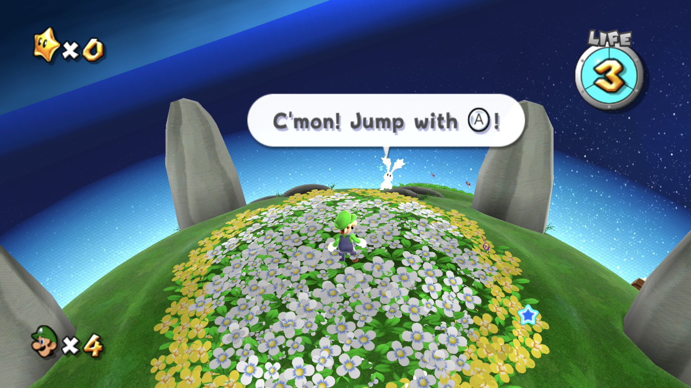
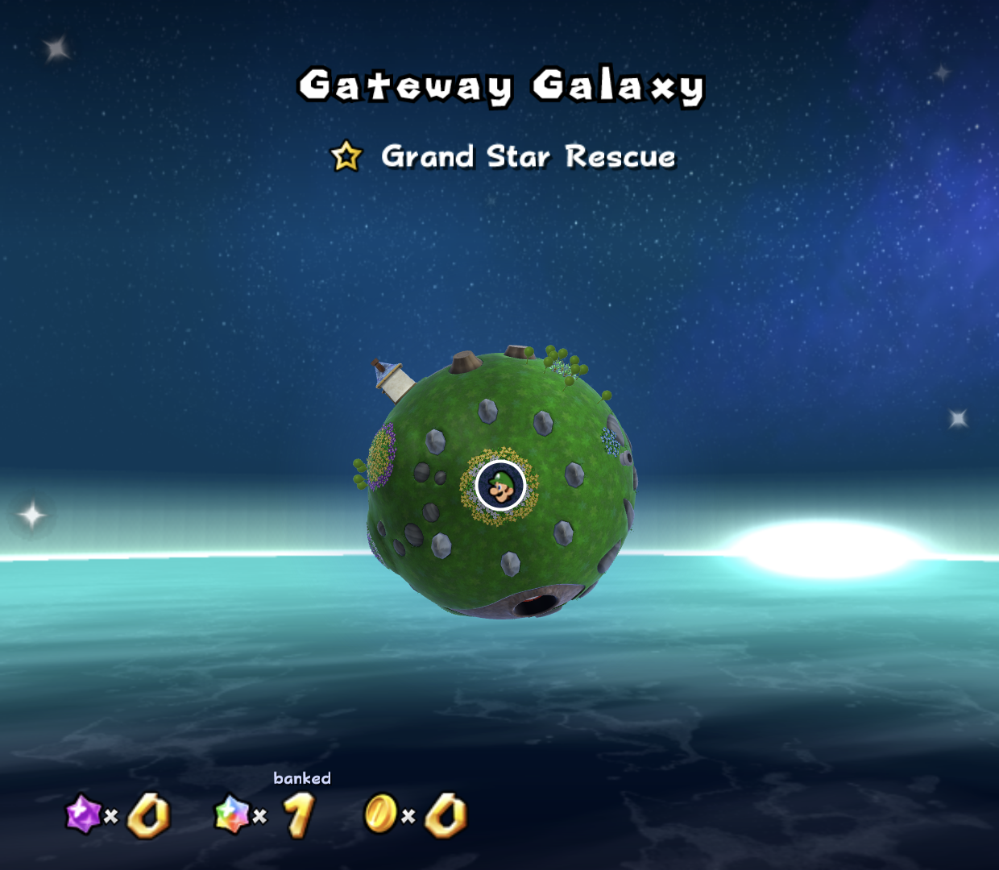

# WiiDS

Reviewed code snapshot: [source/](source/) (runtime, Android frontend, translators and build tools).
The **complete matching source bundle**, including the large approved presentation payload, is the named
`WiiDS-1.0-source.zip` asset in [Releases](https://github.com/Maddex712/WiiDS/releases).
GitHub's automatic Source code ZIP and this Git tree omit that large media payload; use the named release source ZIP to rebuild the exact package.

Release preparation: [source and rebuild notes](docs/release/SOURCE-RELEASE.md),
[release checklist](docs/release/RELEASE-DRAFT.md), and
[component credits](docs/release/WIIDS-NOTICE.md). The final APK's matching source
archive and SHA-256 checksums belong beside it under GitHub Releases.

**Wii and GameCube favourites, running natively on the AYN Thor, with a second screen that works like a DS.**

WiiDS turns the AYN Thor's two displays into something that feels like a Nintendo handheld that never
existed: the game runs on the top screen, and the bottom screen gets its own purpose-built companion,
such as a live course map, a stored-item box, Star Coin slots or an episode guide. The games
aren't emulated. They run as native Android code through static recompilation and decompilation ports.

> **WiiDS 1.0 — first full release.** Download the signed Android APK, matching source and checksums from
> [GitHub Releases](https://github.com/Maddex712/WiiDS/releases). Bring your own supported game discs.
> The single APK includes all seven engines, setup tools and authorised mod patches, with no disc images.

> **Bring your own supported base-game dumps; WiiDS handles the rest.**
> MSMBWii and Eclipse installers are bundled. Retro Rewind downloads directly in-app.
> **Galaxy is now integrated too; no second APK is required.** See [First launch](#first-launch)
> and [supported dump requirements](#what-youll-need).

  

## Games

| Game | How it runs | The second screen | Disc (see below) |
|---|---|---|---|
| **Mario Kart Wii** | The original Wii racer, through DriftDroid / WiiCompiled static recompilation | Independent overhead course map, racer portraits, standings, held items and timer | Europe/PAL, `RMCP01` revision 0 |
| **Retro Rewind** | The community Mario Kart Wii expansion, in its own launcher entry | The Mario Kart companion with a matching supported-course map cache | Same Mario Kart Wii disc; install the content pack in-app |
| **New Super Mario Bros. Wii** | Static recompilation (NSMB Wii recompilation) | Course progress, Star Coin tray, score, stored-item box and world route with NSMB2-style world bubbles | USA, `SMNE01` revision 1 |
| **MSMBWii: Just a Little Adventure** | The same engine, with MidiGuyDP's fan level pack | The same companion, with its own case and save | NSMB Wii disc above; mod included |
| **Super Mario Sunshine** | Decompilation port, built for Android | Enlarged area map and Mario marker, moving cloud backdrop, postcard, episode Shines and original-art counters; live title sky in menus | USA, `GMSE01` revision 0 |
| **Super Mario Eclipse 1.1.0** | Sunshine expansion in its own native runtime processes | The same live-map companion, with Eclipse-specific area and menu handling | Uses your USA Sunshine disc; official patch and installer included |
| **Super Mario Galaxy 1** | Native Galaxy-Android/Petari port inside WiiDS; own-disc conversion and lower bake are integrated | Live counters, textured GPU planet with matched actor visibility/matrices and player marker; Gardens flat map | USA `RMGE01` revision 0; Android API 32+ |

Galaxy setup automatically generates its private lower-screen art and models from your disc. Read [Galaxy setup/migration and current limits](docs/release/GALAXY-SETUP.md). **The new integration was validated on desktop/Android emulation, not a physical Thor.** Earlier Thor images retain their original development-build scope.

Read the [game guide](docs/GAMES.md) for each game's setup, companion screen and current limitations.

## First launch

You need the **WiiDS APK and your own supported base-game dumps**: PAL Mario Kart Wii
`RMCP01` revision 0, USA NSMB Wii `SMNE01` revision 1, or USA Sunshine `GMSE01` revision 0.
Import only the games you own. See [What you'll need](#what-youll-need) for the detailed
revision, format and NSMB disc-metadata requirements. **All three mods are set up inside
WiiDS; no separate mod APKs or companion apps are needed.**

1. Download the signed ARM64 APK from [Releases](https://github.com/Maddex712/WiiDS/releases),
   install it on your Thor and open **WiiDS**. Android may ask you to allow installation from
   your browser or file manager.
2. A preparation screen unpacks the bundled cases, music and companion artwork. With no games
   imported yet, **Your games** opens automatically. Allow storage access to search for your own
   dumps, or use **Choose file** for a single image. For split WBFS, keep `.wbfs` and all `.wbf1`
   (and later numbered) parts together and use **Search again**, which collects the sibling parts.
   **Choose file** opens only the selected file. Exact supported regions and revisions are listed below.
3. Import a supported disc and keep WiiDS open while it checks and prepares the game.
   You can import just the games you own; the seven visible cases are not supplied ROMs.
4. **MSMBWii:** its bundled mod installation starts automatically after importing NSMB Wii. If it was
   cancelled or did not finish, its card offers **Install mod** or **Retry mod installation**.
   **Eclipse:** after importing Sunshine, choose **Install Eclipse**. If cancelled,
   **Retry Eclipse installation** tries the bundled patch again. Both mod patches come with WiiDS;
   you do not need to find or copy separate mod files.
   **Retro Rewind:** press **Y** in the library or open **Retro Rewind updates** in Options.
   WiiDS downloads and installs the newest pack supported by this APK from the official servers;
   this step needs internet access. Each mod has its own case and separate save profile.
5. Return to the case shelf. Use the Thor's physical controls to browse. Press **A** to choose a
   game family, choose Original or its mod, then **A** to open the case and **A** again to select
   its disc and launch. **B** returns one step; **X** opens Options.
   Gameplay uses physical controls, with each game's companion on the lower screen.

Imports and mod installations need extra free storage beyond the APK itself. Eclipse creates its own
separate game image. Updating WiiDS in place keeps existing profiles; uninstalling the app can remove them.

### Super Mario Galaxy setup

Galaxy 1 is in the same APK. Supply a clean **USA RMGE01 revision 0 ISO**, then choose
**Set up Galaxy** in Your games. Keep setup open while it extracts/cooks and generates
the lower-screen assets. No helper or PC bake is required. Galaxy needs API 32+ and
additional free space; see the [setup and legacy-profile migration guide](docs/release/GALAXY-SETUP.md).
Galaxy 2 is not supported. The other six entries retain their existing imports and saves.

## Highlights

- **The complete presentation:** selected retail/fan covers and discs, Wii Menu music and UI sounds, original HUD/fonts/settings artwork and cached lower-screen maps are bundled. Existing user overrides and saves are preserved.
- **Seven cases with matching artwork:** white Mario Kart/Retro Rewind, red NSMB/MSMBWii, black Sunshine/Eclipse.
- **Printed case spines:** Mario Kart, NSMB Wii and Sunshine use crops from retail full-cover scans;
  Retro Rewind and Eclipse use community cover artwork. MSMBWii's spine is an explicit custom
  adaptation. [Artwork sources](docs/GAMES.md#case-artwork).
- **One APK, separate saves.** Eclipse's official 1.1.0 patch and MSMBWii's pack are bundled; Retro Rewind installs from its official servers. No companion APK is required.
- **A real game shelf.** A carousel of game cases: open one, and the disc lifts out and spins up as the
  game boots. Wii games sit together on the shelf; Sunshine and Eclipse use black
  GameCube cases with correctly sized 8 cm mini discs.
- **Stable family stacks.** Each original game and its mod move together when browsing the main
  shelf. The NSMB/MSMBWii pair keeps its draw order when moving back to Mario Kart, and selecting
  an exposed case slice opens the matching family.
- **Bottom screens designed per game**, built from each game's own art (and, for Mario Kart and NSMB, its fonts) rather than a generic overlay.
- **NSMB2-style item reserve** for New Super Mario Bros. Wii: a spare power-up waits in the box on the
  bottom screen, and pressing R3 drops it from the top of the screen.
- **Video options:** 1080p rendering and 60 FPS defaults, with an optional 120 FPS setting.
  Mario Kart Wii and NSMB Wii use experimental presentation interpolation while their game logic
  stays at 60 Hz. The Sunshine/Eclipse 120 FPS option is also experimental; it is not a sustained-performance guarantee.
- **Retro Rewind** 6.13.0–6.13.1, installed and updated in-app from the official servers. Newer versions need a matching engine build first.

## New in 1.0

Galaxy uses relocated native memory inside a non-debuggable WiiDS process, with its own
NAND/settings/import profile. Its Back menu includes Quick Save and Controls > Buttons.
WiiDS Options has a controller-button chooser, and NSMB/MSMBWii have a Controller tab.
See [1.0 release/validation notes](docs/release/V1.0.md).

## Screenshots

Genuine captures from an AYN Thor, with a caption bar added. Where both screens are shown, the top screen is above and the bottom screen below.
Game titles identify Original, Retro Rewind and the other mod entries separately. Mario Kart and
Retro Rewind retain their existing gameplay captures because their presentation is unchanged.
Original Sunshine's Airstrip and title-sky images below were captured in **WiiDS 0.9.0-beta.5**.
The unchanged launcher, NSMB and Eclipse images retain their **beta.3** labels, as do Sunshine's
older file-selection and case captures. Mario Kart images retain their existing capture context.
Each image identifies the build that actually produced it.
Captures document their named scene, rather than implying every course or stage was retested.

### Launcher and Options — captured in WiiDS 0.9.0-beta.3

Captures from the installed beta.3 build, with each complete upper display above its lower display.
The shelf now keeps original/mod families together during transitions, including NSMB/MSMBWii when
moving back to Mario Kart. Retail and community scanned spines are visible on the angled cases.
These are launcher captures; each gameplay section below identifies its game and capture context.

  
  

  
  

### Mario Kart disc launch

This earlier Mario Kart capture shows the disc-lift animation; its game and lower-screen design are unchanged.

  

### Mario Kart Wii and Retro Rewind

  
  

### New Super Mario Bros. Wii

Fresh WiiDS 0.9.0-beta.3 captures of **Original New Super Mario Bros. Wii**. The World 1-1 companion
shows lives, goal-flag progress, the Star Coin tray, score and reserve box; coins and time remain above.
The world-map companion shows Mario on the actual route with linked NSMB2-style world bubbles below.

  
  

### MSMBWii: Just a Little Adventure

Fresh WiiDS 0.9.0-beta.3 **library capture** of MSMBWii's red case, mod disc and readiness panel.
MSMBWii shares the companion design shown in the Original NSMB Wii screenshots above and keeps its
own save profile.

  

### Super Mario Sunshine

**Original Super Mario Sunshine in WiiDS 0.9.0-beta.5:** the larger Airstrip overview fills the
lower map panel, with Mario's marker, postcard and original-art counters over moving clouds.
The upper capture shows the complete MARIO label. The title capture shows the game's live sky
and birds on both displays; a still image illustrates the scene, not its animation rate.

  
  

These unchanged file-selection and black GameCube case images remain labeled **WiiDS 0.9.0-beta.3**.

  
  

### Super Mario Eclipse 1.1.0

Fresh WiiDS 0.9.0-beta.3 captures of **Super Mario Eclipse 1.1.0**: tutorial trainer dialogue and its
black GameCube case. The lower screen shows the current purple area map, arrival photo and original-art
counters. Eclipse's game data and saves stay separate from regular Sunshine.

  
  

## What you'll need

- An **AYN Thor**. WiiDS is built around its two screens. Single-screen devices are planned later.
- **Your own game discs**, dumped yourself (for example with CleanRip on a Wii). Each game
  is built from one exact version of the disc, so the region and revision must match the table below.
  Import supported images through **Your games**; the app verifies their supported version.

### Exact game files for each game

| Game | Disc you need | Game ID | Region | Revision | Redump SHA-1 of a clean dump |
|---|---|---|---|---|---|
| Mario Kart Wii | Mario Kart Wii | `RMCP01` | Europe (PAL) | 0 | n/a |
| Retro Rewind | the same Mario Kart Wii disc | `RMCP01` | Europe (PAL) | 0 | n/a |
| New Super Mario Bros. Wii | New Super Mario Bros. Wii | `SMNE01` | USA | **1** | `aa7b134a7606435ddcd735f2964ebdecde38c2ef` |
| MSMBWii: Just a Little Adventure | the same NSMB Wii disc | `SMNE01` | USA | **1** | `aa7b134a7606435ddcd735f2964ebdecde38c2ef` |
| Super Mario Sunshine | Super Mario Sunshine (GameCube) | `GMSE01` | USA | 0 | `8d094f2c5c112aba9660f0478b16c7f2caf63cbf` |
| Super Mario Eclipse 1.1.0 | the same Sunshine source disc; apply the included official patch | `GMSE01` source → `GMSE04` installed | USA source | 0 (source) | same clean Sunshine source hash above |

For Eclipse, first import the unchanged supported Sunshine disc, then choose **Install Eclipse**.
WiiDS checks the source disc, bundled 1.1.0 patch and resulting image, and keeps Eclipse's image,
settings and saves separate from regular Sunshine. The exact supported prepatched Eclipse image
can also be imported; other images sharing the `GMSE04` header are not accepted as the same build.
If installation is cancelled, **Retry Eclipse installation** reuses the bundled patch.

**Not supported (yet):** the USA Mario Kart Wii disc (`RMCE01`), other regions, NSMB Wii revisions 0 and 2,
and PAL or Japanese Super Mario Sunshine.

**Supported disc-image formats:**

| Format | Extension | Accepted |
|---|---|---|
| Plain disc image | `.iso`, `.gcm` | ✅ |
| Dolphin compressed | `.rvz` | ✅ |
| Wii backup | `.wbfs` (including split `.wbf1`) | ✅ |
| Other compressed images | `.wia`, `.gcz`, `.ciso` | ✅ |
| NKit | `.nkit.iso`, `.nkit.gcz` | ❌ Convert to RVZ or ISO in Dolphin first |

For split WBFS images, keep the `.wbfs` file and its `.wbf1`/later numbered parts in the same folder.
Grant storage access and use **Search again** in **Your games** so WiiDS finds all the sibling parts.
**Choose file** grants access to one selected file and does not collect the other parts.

**How to check your disc:** in Dolphin, the game list shows the Game ID. Right-click the game, choose
**Properties → Info**, and look at **Revision**.

## Included mods and presentation

All three mod integrations are included in the one APK:

- **Retro Rewind** (Mario Kart Wii): its native runtime and 398 rendered lower-screen maps are bundled.
  The actual track/content pack installs and updates in the app from Retro Rewind's official servers.
  Compatibility checks keep the pack aligned with the included runtime; cached maps still require
  the loaded course archive's matching identity and SHA-256.
- **MSMBWii: Just a Little Adventure** (NSMB Wii): its native runtime and level-pack archive are bundled.
  Mod installation starts automatically after importing the supported NSMB Wii disc, with its own
  save profile. Its card offers **Install mod** or **Retry mod installation** if it did not finish.
- **Super Mario Eclipse 1.1.0** (Sunshine): its native runtime, unchanged official VCDIFF patch and
  on-device installer are bundled. Apply the patch to your own supported Sunshine disc through
  **Your games → Install Eclipse**. No separate Eclipse app or downloaded game image is required.
  **Retry Eclipse installation** uses the bundled patch again after cancellation.

The complete selected presentation is also bundled: retail/fan covers and discs, printed case spines, Wii Menu music,
UI sounds, companion HUDs/fonts, menu/settings art, retail maps and the Retro Rewind map cache.
Its release manifest records each file's size and SHA-256. This presentation
does not replace the required game discs or Retro Rewind content installation. Existing valid user
overrides remain separate and preserved. See the [component notices](docs/release/WIIDS-NOTICE.md)
for mod and presentation credits and terms.

## Credits

WiiDS stands on the work of these projects and people:

- **DriftDroid** (dorPXP) and **WiiCompiled** (patchzyy): the Mario Kart Wii static recompilation and Android runtime
- **NSMB Wii recompilation** (WitherBlitz): the New Super Mario Bros. Wii runtime
- **sms-pc-port** and **sms-launcher** (Chase Myers / chasem-dev), on the **Super Mario Sunshine decompilation** (doldecomp)
- **Retro Rewind** (ZPL and the Retro Rewind team)
- **MSMBWii: Just a Little Adventure** (MidiGuyDP and Fredo), using **Another Super Mario Bros. Wii** code (Skawo, Treeki)
- **Super Mario Eclipse** (Eclipse Team / JoshuaMKW), **BetterSunshineEngine**, **BetterSunshineMoveset** and **SunshineHeaderInterface**
- **Some-Crappy-Edits**: Eclipse fan disc design; the selected Eclipse cover was supplied by the owner and its creator is unverified
- **GameTDB and its cover contributors**: the retail and community full-cover images used for printed
  case spines. The [game guide lists the source pages](docs/GAMES.md#case-artwork); MSMBWii is a custom adaptation.
- **Nintendo**: original game artwork, fonts/UI and the supplied Wii Menu recording; approved generated disc/app-logo artwork is identified in the component notices
- **Dolphin**, **SDL**, **aurora** and the other open-source libraries each project credits

The Mario Kart Wii work also lives in its own repository: [Maddex712/mkwii-thor](https://github.com/Maddex712/mkwii-thor).

## Legal

WiiDS is an unofficial fan project. It is not affiliated with, endorsed by or sponsored by Nintendo.
Mario Kart, Super Mario, New Super Mario Bros., Super Mario Sunshine, Wii and GameCube are trademarks of
Nintendo. No original or patched ROM/disc images, personal saves or private keys are included.
The release does include compiled native engines, the specified mod components and the selected
presentation assets described above. Code licences do not relicense third-party artwork or music.
Please own the games you play.

## Development assistance

Development assistance: OpenAI Codex. The owner-approved minimal app icon was generated with OpenAI's built-in image-generation tool. Game and mod creators are credited in the component notices.

### Galaxy and controller updates — October 22 development captures

These are genuine Thor captures from the separate-helper development build before
the one-APK integration. They illustrate the existing presentation, not validation of
the final ARM64 1.0 APK. Opening/Gateway checks do not establish full-game compatibility.

