# WiiDS

**Wii and GameCube favourites, running natively on the AYN Thor, with a second screen that works like a DS.**

WiiDS turns the AYN Thor's two displays into something that feels like a Nintendo handheld that never
existed: the game runs on the top screen, and the bottom screen gets its own purpose-built companion,
such as a live course map, a stored-item box, Star Coin slots or an episode guide. The games
aren't emulated. They run as native Android code through static recompilation and decompilation ports.

> **Status: in development.** There are no app downloads yet. This page shows where the project is,
> using real captures from an AYN Thor. You'll always need your own game discs; WiiDS never includes
> or provides games, ROMs or game files.

  

## Games

| Game | How it runs | The second screen | Disc it needs |
|---|---|---|---|
| **Mario Kart Wii** and **Retro Rewind** | Static recompilation (DriftDroid / WiiCompiled) | Live overhead course map with every racer, standings and race timer | Europe/PAL, `RMCP01` revision 0 |
| **New Super Mario Bros. Wii** | Static recompilation (NSMB Wii recompilation) | Course progress, Star Coins, score and an NSMB2-style stored-item box, all in the game's own fonts and art | USA, `SMNE01` revision 1 |
| **MSMBWii: Just a Little Adventure** | The same engine, with MidiGuyDP's fan level pack | The same companion, with its own case and save | NSMB Wii disc above, plus the mod |
| **Super Mario Sunshine** | Decompilation port, built for Android | A "Delfino Tours" episode tracker, the game's own live title sky, and FLUDD's tank | USA, `GMSE01` revision 0 |

## Highlights

- **A real game shelf.** A carousel of game cases: open one, and the disc lifts out and spins up as the
  game boots. Wii games sit together on the shelf; the GameCube case comes last, with a
  correctly sized 8 cm mini disc.
- **Bottom screens designed per game**, built from each game's own art (and, for Mario Kart and NSMB, its fonts) rather than a generic overlay.
- **NSMB2-style item reserve** for New Super Mario Bros. Wii: a spare power-up waits in the box on the
  bottom screen, and pressing R3 drops it from the top of the screen.
- **Widescreen and high frame rates**: Super Mario Sunshine in 16:9 at 1080p, 60 FPS with a 120 FPS option;
  Mario Kart Wii and New Super Mario Bros. Wii at 60 FPS with an experimental interpolated 120 FPS mode.
- **Retro Rewind** 6.13.0–6.13.1, installed and updated in-app from the official servers. Newer versions need a matching engine build first.

## Screenshots

Genuine captures from an AYN Thor, with a caption bar added. Where both screens are shown, the top screen is above and the bottom screen below.

### The launcher

  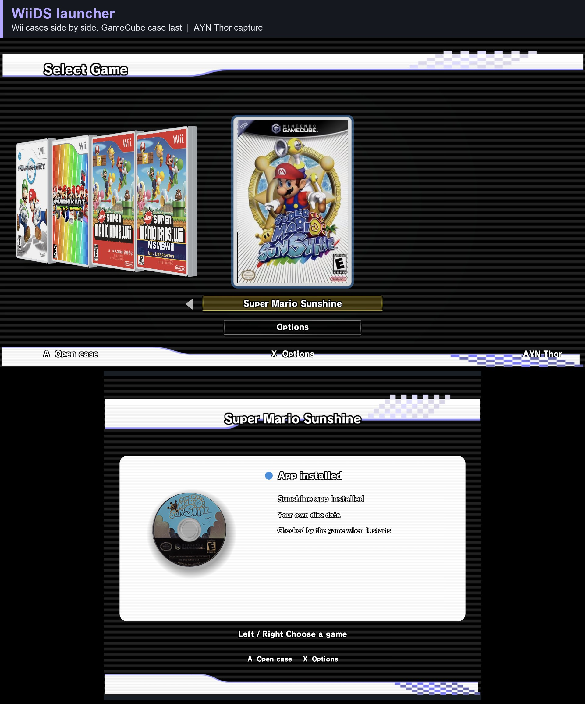
  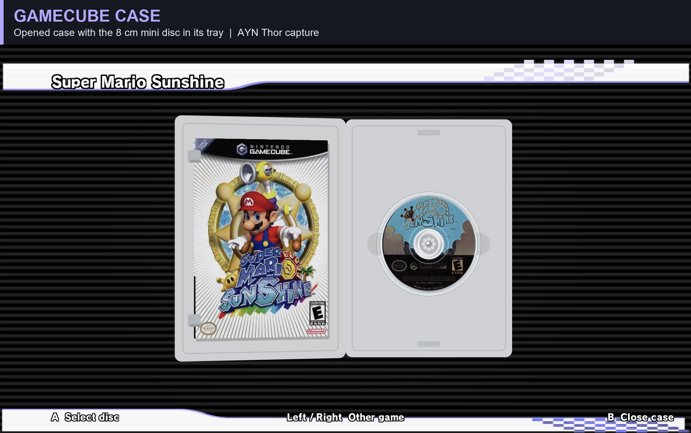

  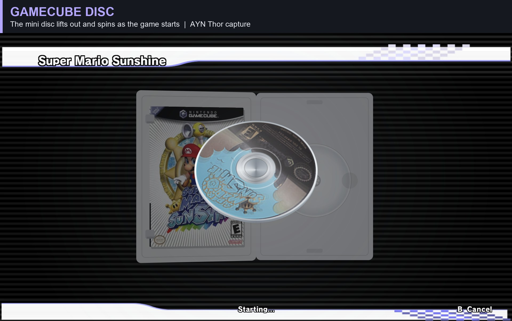
  

### Mario Kart Wii and Retro Rewind

  
  

### New Super Mario Bros. Wii

  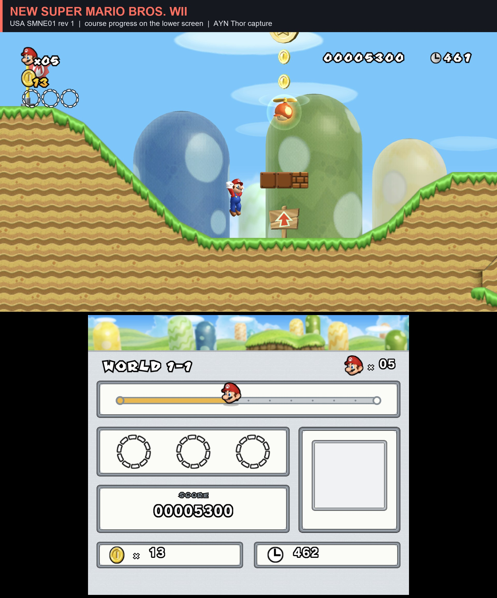
  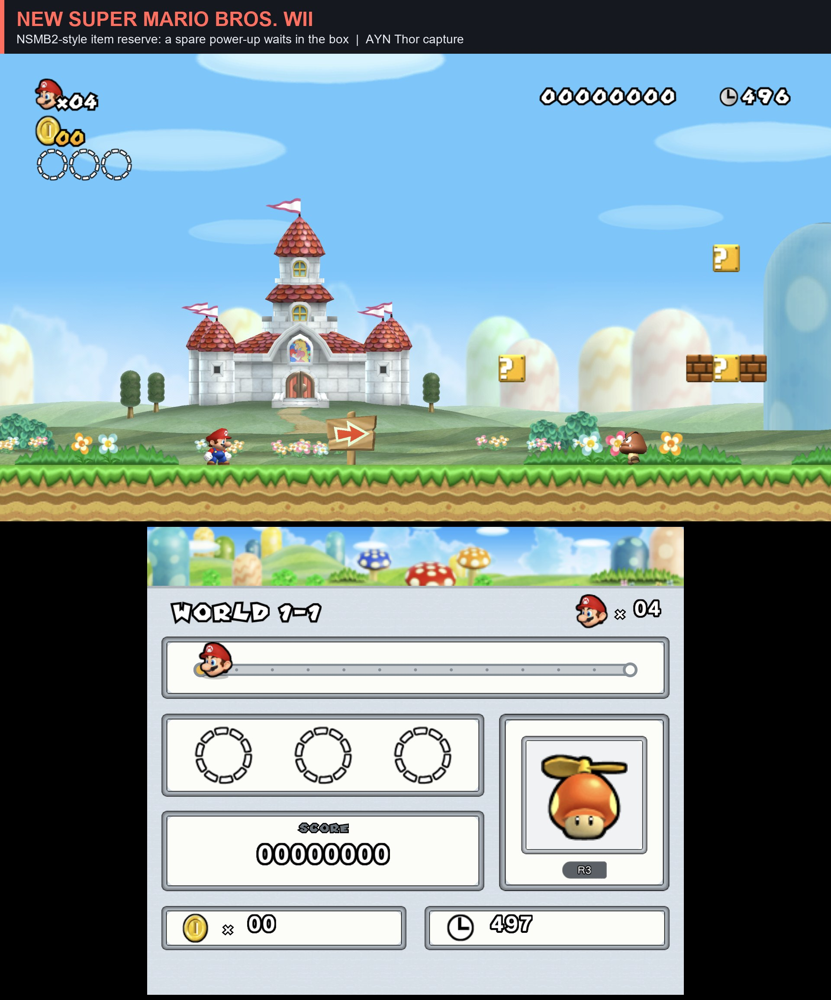

  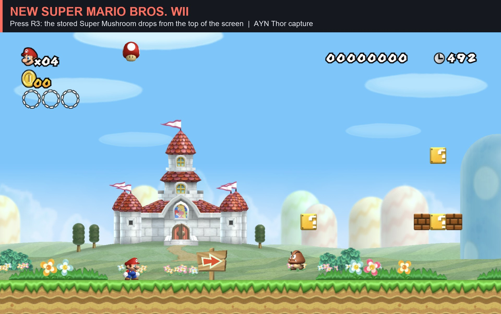
  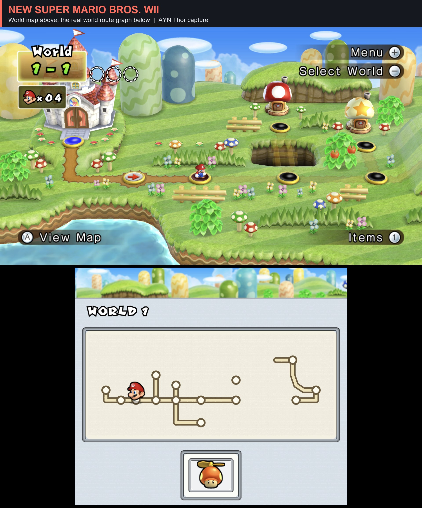

### MSMBWii: Just a Little Adventure

  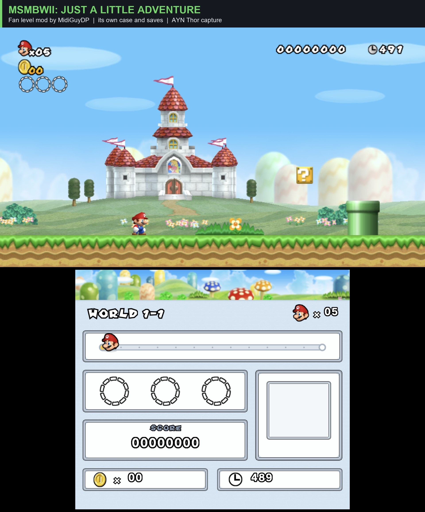

### Super Mario Sunshine

  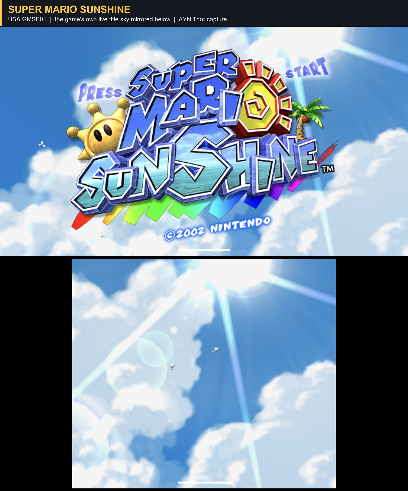
  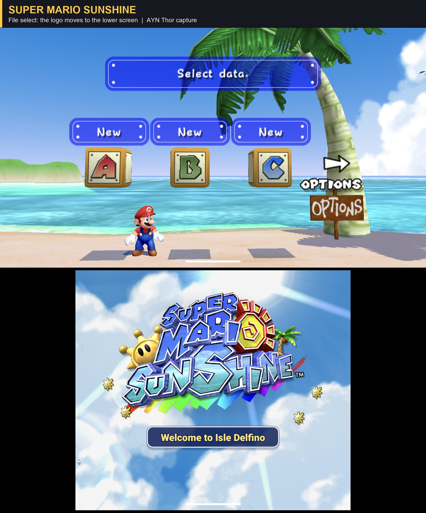

  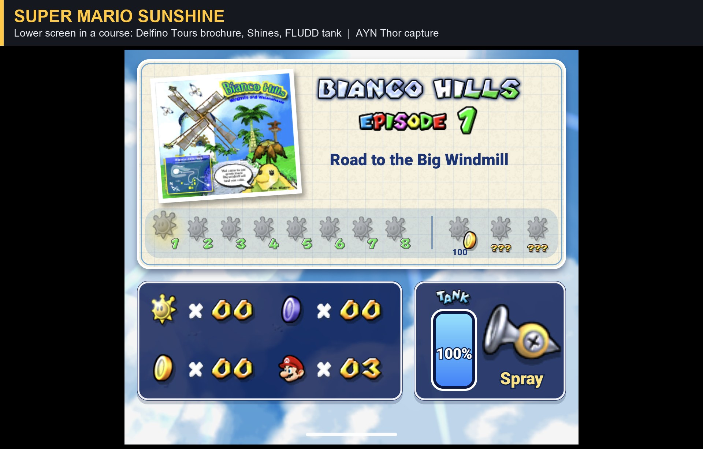
  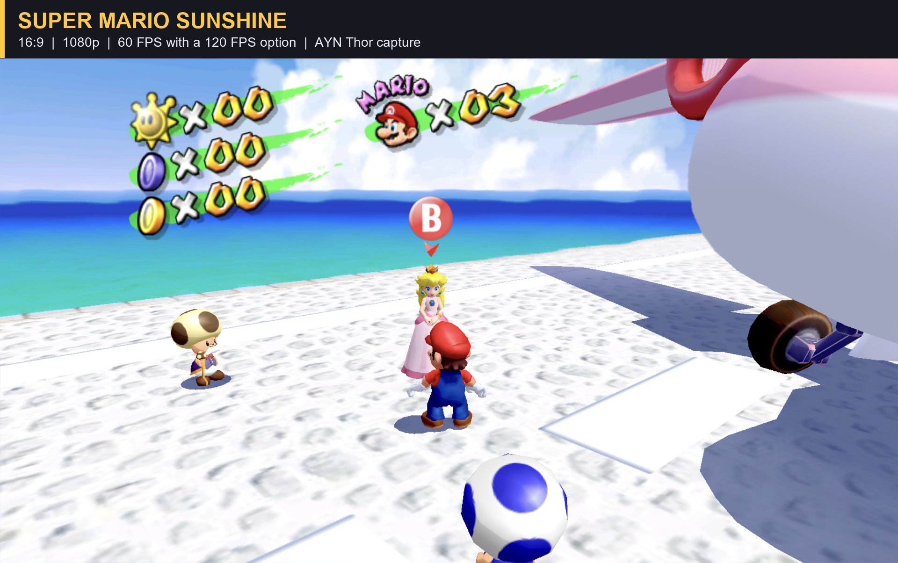

## What you'll need

- An **AYN Thor**. WiiDS is built around its two screens. Single-screen devices are planned later.
- **Your own game discs**, dumped yourself. WiiDS will tell you exactly which disc (game ID, region and
  revision) each game needs and which file formats it accepts.
- For Retro Rewind and MSMBWii, the mods themselves come from their official sources.

## Credits

WiiDS stands on the work of these projects and people:

- **DriftDroid** (dorPXP) and **WiiCompiled** (patchzyy): the Mario Kart Wii static recompilation and Android runtime
- **NSMB Wii recompilation** (WitherBlitz): the New Super Mario Bros. Wii runtime
- **sms-pc-port** and **sms-launcher** (Chase Myers / chasem-dev), on the **Super Mario Sunshine decompilation** (doldecomp)
- **Retro Rewind** (ZPL and the Retro Rewind team)
- **MSMBWii: Just a Little Adventure** (MidiGuyDP and Fredo), using **Another Super Mario Bros. Wii** code (Skawo, Treeki)
- **Dolphin**, **SDL**, **aurora** and the other open-source libraries each project credits

The Mario Kart Wii work also lives in its own repository: [Maddex712/mkwii-thor](https://github.com/Maddex712/mkwii-thor).

## Legal

WiiDS is an unofficial fan project. It is not affiliated with, endorsed by or sponsored by Nintendo.
Mario Kart, Super Mario, New Super Mario Bros., Super Mario Sunshine, Wii and GameCube are trademarks of
Nintendo. No games, ROMs, disc images or extracted game files are distributed here. Please own the games
you play.
