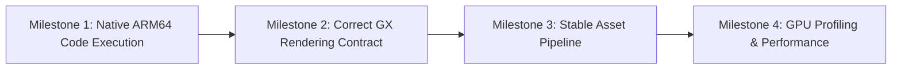
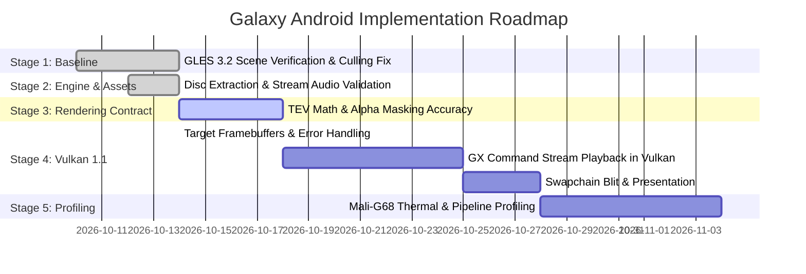

# Super Mario Galaxy Native Engine Porting & Architecture Roadmap

## 1. Executive Summary & Feasibility Verdict

| Subsystem / Milestone | Feasibility Status | Current State |
| :--- | :--- | :--- |
| **Native ARM64 Execution** | **High Feasibility** | **Working**: C++ decompiled source compiles and executes natively on 64-bit ARM via Clang without emulation. |
| **Wii Disc Asset Extraction** | **High Feasibility** | **Working**: Extraction pipeline unpackages retail Wii disc partitions, decrypts archives (`.szs`, `.arc`), and caches models and audio. |
| **Faithful GX-to-Android Rendering** | **High Effort / Active** | **Active Baseline (GLES 3.2)**: Core scene rendering, TEV stages, and geometry rendering functional. Lake culling and TEV color scaling recently resolved. |
| **Native Vulkan 1.1 Backend** | **In Progress (Experimental)** | **Infrastructure Phase**: Instance, device, swapchain, depth targets, and render passes implemented. GX draw command translation pipeline is in active development. |
| **Mali-G68 / Adreno Performance** | **Proven Incrementally** | **In Progress**: Eliminating memory stalls, managing tile memory for EFB copies, and caching pipeline state. |

---

## 2. The Four Distinct Engineering Milestones

A successful native port requires separating four distinct engineering challenges:

1. **Native ARM64 Compilation & Execution**:
   - Compiling C++ game logic (physics, camera, state machines, actor systems) for `aarch64`.
   - Resolving endianness, memory alignments, and substituting Wii OS functions with native POSIX/Android equivalents.
2. **Correct GX Rendering Contract**:
   - Faithfully reproducing Nintendo's GameCube/Wii GX fixed-function pipeline, matrix stacks, TEV combiner arithmetic, and depth/culling conventions in modern graphics APIs.
3. **Asset Pipeline Integrity**:
   - Extracting and parsing assets from retail discs (Wii partition decryption, Yaz0 decompression, `.brres`/`BMD` decoding, PCM audio streaming).
4. **Hardware Validation & Profiling**:
   - Profiling sustained thermals, frame pacing, and tile memory utilization across both ARM Mali (TBDR) and Qualcomm Adreno architectures.

---

## 3. Rendering Architecture Strategy: Custom HAL vs. Third-Party Engines

### Architecture Options Evaluated

| Architecture | Porting Feasibility | Fidelity to Original Game | Assessment |
| :--- | :--- | :--- | :--- |
| **Option A: Custom GX Backend (Recommended)** | **Direct / Preserves Engine** | **100% 1:1 Semantics** | Preserves original JSystem scene graph and GX command stream. Translates GX commands directly to GLES 3.2 and Vulkan 1.1. |
| **Option B: bgfx Abstraction** | Moderate | Partial | Provides cross-API boilerplate, but does not solve GX display-list translation, TEV emulation, or EFB capture behavior. |
| **Option C: Godot 4 / External Engine** | Low / High Friction | Risky / Complete Rewrite | Requires rewriting the entire actor framework, collision system, camera, and physics into Godot's node hierarchy. |

**Decision**: **Option A (Custom GX Backend)** is retained as the architectural foundation. OpenGL ES 3.2 serves as the verified production baseline, while Vulkan 1.1 is developed incrementally behind an explicit runtime backend switch.

---

## 4. Technical Mali (TBDR) & Mobile GPU Realities

### A. Ring Buffers & Memory Coherency
- Persistently mapped, host-coherent uniform/storage buffers ring-buffered across frames reduce dynamic reallocation overhead.
- *Caveat*: Ring buffers avoid explicit CPU flush calls, but GPU queue synchronization and device memory alignment constraints must still be honored to avoid pipeline bubbles.

### B. EFB (Embedded Framebuffer) Handling: Selective Subpasses
Super Mario Galaxy relies heavily on EFB captures (e.g. water surface refraction, star pointer glow, heat distortion, depth-of-field). These must be classified by access pattern:
1. **Intra-Pass (Transient Subpasses)**: Data produced and consumed within the same render tile without leaving on-chip SRAM.
2. **Inter-Pass (Persistent Textures)**: EFB snapshots sampled in later frames or passes must be backed by persistent images.
3. **CPU Readbacks**: Avoided or minimized, as reading GPU memory back to the CPU stalls the pipeline.

### C. Shader Compilation: Pipeline Caching & Prewarming
- SPIR-V is an intermediate representation; the Mali driver compiler still compiles SPIR-V into Mali machine bytecode.
- To prevent runtime hitching:
  - Cache compiled `VkPipeline` state via `VkPipelineCache`.
  - Prewarm common shader combinations during level load sequences.

### D. Precision Qualification
- Precision qualifiers (`mediump` / FP16) are evaluated on a per-shader basis.
- Texture coordinates, depth projections, and certain TEV arithmetic require full 32-bit float (`highp`) to prevent precision artifacts, banding, or clipping glitches.

---

## 5. Practical Implementation Roadmap

1. **Stage 1 — Stable GLES 3.2 Baseline**:
   - Maintain OpenGL ES 3.2 as the verified default renderer.
   - Validate geometry winding, culling (`GL_FRONT` for `GX_CULL_BACK`), and TEV color range normalization.
2. **Stage 2 — Native Engine & Asset Pipeline Validation**:
   - Verify disc extraction, texture dictionary loading, and audio stream reproduction across all world archives.
3. **Stage 3 — Complete GX Rendering Contract**:
   - Ensure pixel-accurate TEV stage combinations, alpha tests, and fog curves.
4. **Stage 4 — Finish Vulkan 1.1 Rendering Path**:
   - Wire the GX draw-record playback into the Vulkan command buffer.
   - Implement pipeline caching (`VkPipelineCache`) and swapchain blitting.
5. **Stage 5 — Device Validation**:
   - Validate visual fidelity across Mali-G68 (Dimensity 920) and Qualcomm Adreno targets before performance tuning.
6. **Stage 6 — GPU Profiling & Optimization**:
   - Measure GPU tile utilization, memory bandwidth, and frame pacing using vendor tools (Arm Mobile Studio / Snapdragon Profiler).
